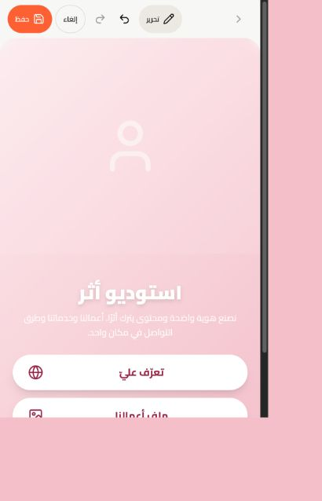
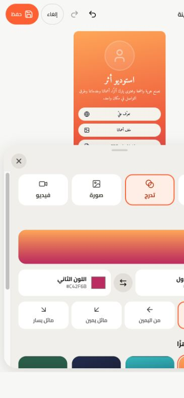
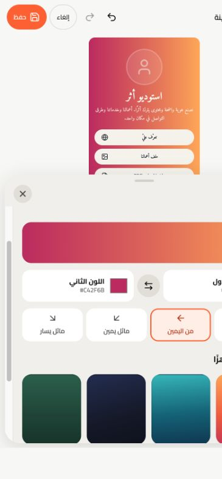
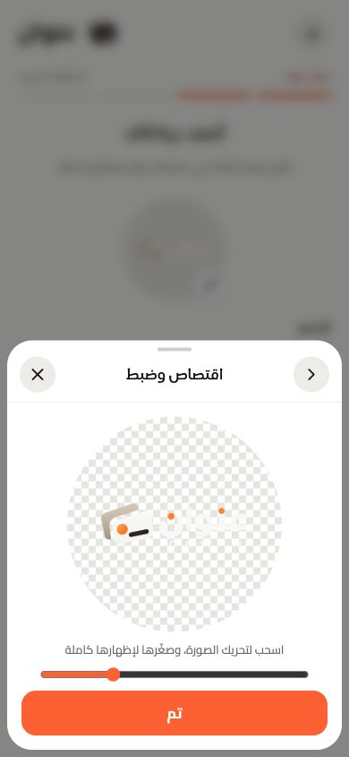
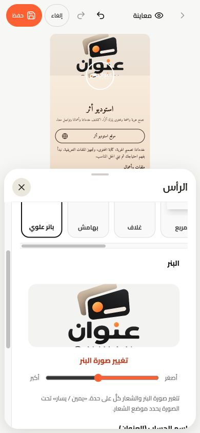
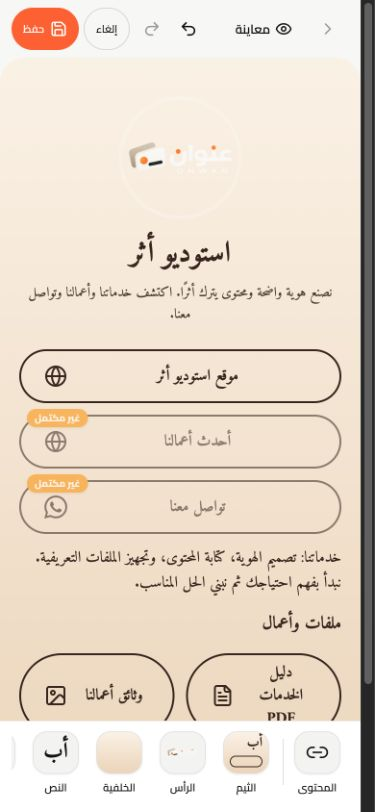
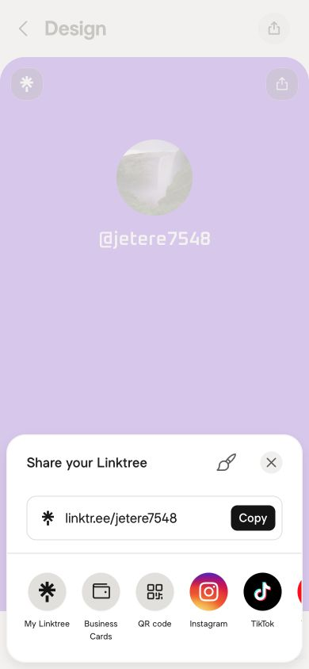
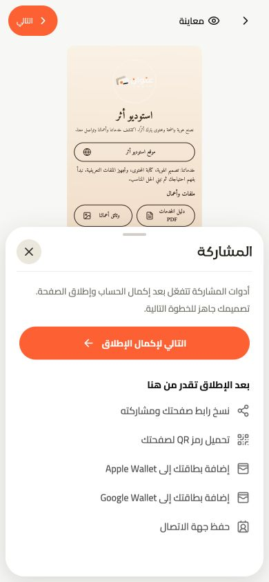
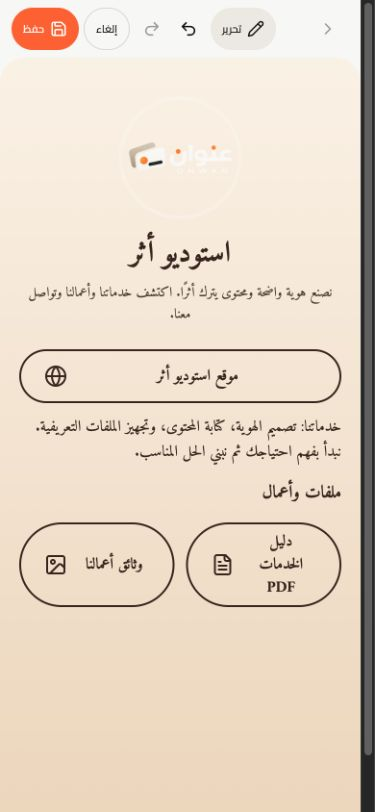
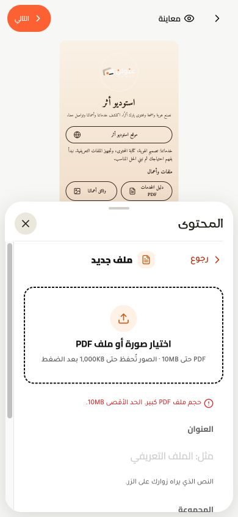

# مراجعة محرر عنوان مقابل Linktree — 23 نوفمبر 2026

هذه مراجعة فعلية في المتصفح، مع تركيز على **المحرر والتعديلات** استجابة لتوجيه صاحب المشروع أثناء الفحص. ما قبل المحرر راجعته بوصفه مدخلًا، وتوقفت قبل موافقة إنشاء الحساب بناءً على طلبه. لا توجد تعديلات أو نشر في حساب Linktree، ولا نشر لصفحة عنوان أو دفع أو تطبيق لترحيلات قاعدة البيانات.

## الحكم الذي تدعمه التجربة

يمكن في عنوان تركيب صفحة عربية تضم اسمًا ونبذة ورابطًا ونصًا ومجموعة صور/ملفات، ومعاينتها وحفظ مسودتها. جرّبت ذلك بالفعل. **لكن سهولة الوصول لصفحة جميلة ليست مضمونة بمجرد اختيار ثيم جميل:** تخصيص الخلفية والأزرار يستطيع كسر القراءة، وتعديل اتجاه تدرج جاهز يغيّر ألوانه أيضًا، والبانر لا يتيح ضبط موضع القص.

الأولوية ليست إضافة خيارات أكثر أو تغيير رحلة البداية كلها. الأولوية أن تعطي الخيارات الموجودة نتيجة متوقعة ومقروءة، مع أدوات يسهل العثور عليها. لا تثبت جلسة خبير واحدة أن مستخدمًا عاديًا سيكمل المهمة بسهولة، ولا أنها أفضل تجربة أو أسرع أداء.

## النطاق والمنهج وحدود الأدلة

- عنوان: الكود المحلي الحالي، أولًا على Vite في المنفذ 5173، ثم تشغيل Workers المحلي الداعم للتخزين على 8787. المكتوب هنا يصف هذه النسخة، وليس ضمانًا عن النسخة المنشورة.
- Linktree: جلسة مسجلة جاهزة، فتح المحرر والتصميم والإضافة والمعاينة والمشاركة فقط. لم أكتب محتوى أو أغيّر اختيار تصميم أو خلفية أو إعداد حساب؛ الحفظ التلقائي محتمل، ولذلك لم أجرّب تركيباته بإحداث تغيير فعلي.
- المتصفح الداخلي هو الأساس. استخدمت Chrome لصندوق البريد الذي حدده المستخدم ولقارئ PDF بعد أن لم يعرضه المتصفح الداخلي. لا محاكي أجهزة ولا محاكاة نظام iOS.
- اللقطات الأساسية لرحلة Workers وLinktree بعروض جوال 375–390 بكسل. بعض لقطات الاستكشاف المبكرة/الموسعة اختلفت أبعادها، بين 325 و507 بكسل، مع تغيّر مساحة المتصفح. أبعاد ملفات الصور مسجلة في `evidence-manifest.json`. لا أستنتج عيب قص أفقي من لقطات الالتقاط غير المتطابقة، ولا أجري مقارنة هندسية أو مقارنة أداء بين المنتجين بهذه اللقطات.
- روابط الوسائط المحفوظة فُتحت مباشرة للتحقق من توفر الصورة وقراءة PDF. النقر على PDF من معاينة المتصفح الداخلي لم يُظهر انتقالًا يمكن التحقق منه؛ فتح نفس الرابط في Chrome عرض الملف. لذلك نجاح التخزين والوصول مثبت، أما سلوك النقر وفتح تبويب جديد عبر جميع المتصفحات فليس مثبتًا.
- فتح حقول النص في متصفح الكمبيوتر لا يظهر لوحة مفاتيح الهاتف الأصلية. **سلوك لوحة مفاتيح iOS/Android، السحب بالإصبع، الارتداد، الكاميرا، وsafe-area لم تُثبت هنا**. لا يوجد ادعاء اجتياز شامل لإمكانية الوصول.
- استُخدم بريد مؤقت بإذن المستخدم والتحقق منه بالرمز. لم تُحفظ رموز أو كلمات مرور في التقرير. ملف PDF تجريبي، وصور الاختبار من ملفات المشروع؛ ليست بيانات عميل.
- «مؤكد» = سلوك أعيد في الواجهة، مع لقطة أو قياس DOM. «اقتراح» = تحسين يحتاج اختبار فهم. «قرار مقصود» = له سند في توثيق المشروع. ما ظهر في قائمة Linktree يثبت وجود مدخل، ولا يثبت نجاح ميزته كاملة.

## الرحلة التي اختُبرت

الأرقام في عمود الدليل هي بادئات أسماء الصور داخل `screenshots/`، وليست أرقام خطوات إضافية.

| الخطوة | ما جُرّب | النتيجة | الدليل |
|---|---|---|---|
| 1 | اختيار صفحة شخصية ثم نشاط تجاري في تجربة أخرى | سليم: المتابعة تتاح بعد الاختيار | 01 |
| 2 | الاسم والنبذة، رفع شعار شفاف والقص | سليم في التجربة: القص يفتح بعد الرفع، والإعداد يُحفظ | 02، 14 |
| 3 | قوالب شخصية وتجارية، «محامي»، بحث بلا نتيجة | سليم: نتيجة مفهومة، ولا انتقال بقالب خارج النتائج، ومسح يعيد القائمة | 03، 15 |
| 4 | حفظ البداية بالبريد وإدخال رمز حقيقي | نجح في البيئتين؛ لا إنشاء حساب عميل في هذه الخطوة | حالة المحرر المسترجعة في 32 |
| 5 | رابط بلا بروتوكول، عنوانه، رابط غير صالح، إخفاء وإظهار | نجح التطبيع إلى HTTPS والإخفاء من معاينة الزائر؛ الخطأ موضح داخل النموذج | 24 |
| 6 | صورة وPDF، نص خدمات، ترتيب بالأسهم، مجموعة شبكية | نجحت الإضافة والعرض والترتيب وتجميع الملفات | 25، 26، 27 |
| 7 | حفظ الوسائط وإعادة تحميل المحرر، فتح الملفات | نجح على Workers؛ الصورة تفتح وPDF يُقرأ في Chrome | 18، 20، 30، 32 |
| 8 | اختيار PDF أكبر من 10MB | رفض واضح قبل إضافته، وبقي المحتوى السابق | 33 |
| 9 | غروب ثم مدار، أحجام كتابة كبيرة وخط عربي آخر | المحتوى بقي عند تبديل الثيم؛ بعض التركيبات مقروء وبعضها لا | 05، 07، 31 |
| 10 | خلفية متدرجة، اتجاهها، صورة: احتواء/تكرار/ملء/تقريب/تعتيم | الأدوات تعمل؛ تأكد فقد اللون الأوسط عند تغيير اتجاه التدرج | 34، 35، 36 + ملف JSON |
| 11 | دائرة، غلاف، بهامش، بانر مستقل | الاختلافات حقيقية؛ قص البانر بلا تحريك، بخلاف صورة الهوية | 14، 37–41 |
| 12 | تعديل الاسم والتراجع، إلغاء عدة تعديلات | رجع الاسم؛ الإلغاء المؤكد أعاد المسودة المحفوظة واحتفظ بالمحتوى | 29، 32 |
| 13 | معاينة عنوان ومشاركته قبل الإطلاق؛ مقابلهما في Linktree | معاينة عنوان تعرض المحتوى المكتمل؛ المشاركة مؤجلة للإطلاق بوضوح | 12، 17، 27، 42 |
| 14 | إكمال الحساب ثم النشر والمشاركة بعد التفعيل | **توقف بطلب المستخدم قبل الموافقة**؛ لم تُختبر بقية الرحلة | `/signup?step=complete` |

الحفظ الأول للوسائط على Vite أخفق برسالة «تخزين الملفات غير مفعّل في هذه البيئة». تشغيل `npm run dev:local` أتاح R2 المحلي، ثم نجح رفع الشعار والصورة وPDF وحفظها. لذلك صُنّفت الرسالة **عائق بيئة تم تجاوزه** وليست عطل منتج منشور. أعاد التشغيل بناء `dist`؛ لم أعدّل كود المنتج أو أنشره. تغييرات العمل الموجودة مسبقًا تُركت كما هي.

## أهم النتائج والإصلاحات حسب الأثر

### E01 — P1 — مؤكد: تغيير الخلفية يستطيع إخفاء النصوص بصريًا

**إعادة التجربة:** اختر «غروب» ← المحرر ← الرأس «بهامش» ← الخلفية ← «تدرج 6» ← معاينة. بقي الاسم والنبذة أبيضين فوق وردي فاتح. ثم اختر الأزرار «حواف فقط»: صارت كتابة الأزرار وحدودها بيضاء فوق الخلفية الفاتحة أيضًا. في لوحة الألوان كانت هذه القيم موصوفة «تلقائي».

الاسم المقاس من DOM كان `rgb(255,255,255)`. طرفا التدرج هما `#FDEEF0` و`#F6C6D0`؛ التباين النظري للأبيض معهما **1.13:1 و1.51:1**. هذا حساب للألوان، وليس قياسًا شاملًا لكل بكسل في التكوين. اللقطة تؤكد صعوبة القراءة في الحالة الفعلية.

**الأثر:** المستخدم يستطيع تخريب قراءة الهوية والروابط بخيارات جاهزة، دون إدخال لون غريب أو فهم سبب المشكلة.

**الحل:** اجعل «تلقائي» مجموعة ألوان متوافقة مع الخلفية الحالية؛ أو سمّه «لون الثيم» إن كان يتبع الثيم فقط. أبقِ اللون المخصص للمستخدم، وأظهر تحذيرًا مع إجراء «اجعل النص مقروءًا». افحص الاسم والنبذة والنصوص وحدود الأزرار ونصها، مع الشفافية والتدرجات، لا الزر الممتلئ فقط. لا تغيّر لونًا اختاره المستخدم يدويًا بصمت.

**معيار القبول:** مصفوفة التدرجات الثمانية × أزرار ممتلئة/حدود × خلفية زر كاملة/شفافة؛ الوضع التلقائي يحقق هدف المشروع 4.5:1 للنص العادي و3:1 للنص الكبير. يحسب الاختبار الخلفية الفعلية تحت النص، ويكشف الحالة غير الآمنة قبل حفظها. تعاد E01 بعد الإصلاح بنفس الخطوات.



### E02 — P2 — مؤكد: تعديل الاتجاه يحذف لونًا من التدرج

**إعادة التجربة:** الخلفية ← تدرج ← «تدرج 1» ← «من اليمين». قست الخلفية المعروضة في DOM قبل الإجراء وبعده:

```css
/* قبل: ثلاثة ألوان */
linear-gradient(170deg, rgb(255,176,87) 0%, rgb(242,100,61) 52%, rgb(196,47,107) 100%)
/* بعد تغيير الاتجاه فقط: لونان */
linear-gradient(270deg, rgb(255,176,87) 0%, rgb(196,47,107) 100%)
```

**الأثر:** المستخدم يطلب تغيير الاتجاه فيحصل على تدرج مختلف لونيًا؛ لا يستطيع تعديل اتجاه القالب مع الحفاظ على مظهره.

**السبب المدعوم بالكود:** `BackgroundSettings.tsx` يقرأ أول وآخر لون، ثم يعيد بناء تدرج ثنائي اللون عند تعديل الاتجاه. التبسيط إلى محرر لونين موجود عمدًا في البنية، لكن فقد لون القالب أثر غير معلن في التجربة.

**الحل:** احتفظ بجميع نقاط اللون ومواضعها عند تغيير الزاوية. تبديل اللونين يعكس ترتيب نقاط التدرج كاملة. إذا أراد المنتج محرر لونين فقط، اجعل التحويل إليه إجراءً صريحًا، ولا تربطه بتغيير الاتجاه.

**معيار القبول:** تغيير الزاوية لا يغيّر عدد نقاط اللون أو قيمها أو نسبها؛ التراجع يعيد القيمة الأصلية كاملة. الاختبار يشمل التدرجات الجاهزة ذات 2 و3 نقاط. الدليل الخام: [gradient-direction-evidence.json](gradient-direction-evidence.json).




### E03 — P2 — مؤكد: البانر يُقص دون أداة لضبط القص

**إعادة التجربة:** الرأس ← «بانر علوي» ← رفع صورة. يظهر رفع/تغيير الصورة وحجم الشعار، دون قص أو تحريك للبنر. قارن ذلك بأداة قص صورة الهوية التي فتحت فور رفعها. البانر في الكود يُعرض بـ`object-cover` داخل نسبة ثابتة، ولا يوفر هذا المسار تحديد موضع التركيز.

**الأثر:** صورة غير مطابقة لأبعاد الغلاف قد تفقد جزءًا مهمًا، ويضطر المستخدم لتجهيز صورة خارج التطبيق. تحريك الشعار أو تكبيره لا يعالج قص الغلاف.

**الحل:** أعد استخدام أداة القص الحالية بنسبة إطار البانر، مع سحب موضع الصورة وإظهار معاينة مطابقة لصفحة الزائر. افصل اسم الإجراء «ضبط الغلاف» عن «ضبط الشعار».

**معيار القبول:** صورة طولية وأخرى عريضة، بهما موضوع قرب الحافة، يمكن تحريكهما لإبقاء الموضوع ظاهرًا. يبقى التركيز والقص بعد الحفظ وإعادة التحميل، وتطابق المعاينة صفحة الزائر عند 375 و390 و430 بكسل.




### E04 — P2 — مؤكد في الوصول، واقتراح في الحل: المشاركة خارج الجزء المرئي من الأدوات

**إعادة التجربة:** افتح المحرر قبل تمرير شريطه الأفقي. في القياس: عرض الشريط 351 بكسل ومحتواه 619؛ زر المشاركة كان بين x=-180 وx=-118، خارج الجزء المرئي. الأدوات تسعة: المحتوى، الثيم، الرأس، الخلفية، النص، الأزرار، الألوان، المشاركة، الإعدادات. الإضافة المرئية والمعاينة العلوية أفضل ظهورًا من المشاركة.

Linktree يضع زر مشاركة في الرأس داخل المحرر والتصميم، وفي المحرر شريط مباشر للإضافة والمعاينة والتصميم. لا يلزم نسخ ترتيبهم أو شكلهم للاستفادة من وضوح الأفعال الأساسية.

**الحل المقترح:** ثبّت المشاركة بجانب المعاينة بعد الإطلاق. قبل الإطلاق أبقِ الحالة «إكمال الإطلاق» واضحة عند فتحها، دون رابط زائف أو QR لصفحة غير منشورة. اجمع تخصيص الشكل تحت مدخل «التصميم»، واجعل خياراته تظهر على مراحل. احتفظ باختصارات الضغط على الاسم/الصورة/العنصر.

**معيار القبول:** مستخدم جديد يجد معاينة ومشاركة/حالة إطلاق الصفحة دون تمرير أفقي؛ 4 من 5 أشخاص يصلون للإجراء الصحيح خلال 10 ثوانٍ دون مساعدة. لا تختفي هذه الأفعال عند الدخول لتخصيص الشكل.





### E05 — P2 — مؤكد في الخطوة الزائدة، واقتراح في الحل: صورة المحتوى تحتاج صورة أخرى لتصبح بطاقة

**إعادة التجربة:** أضف ← ملف ← صورة ← «بطاقة مصوّرة». يظهر «إرفاق صورة البطاقة» و«أرفق صورة لإكمال البطاقة المصوّرة» رغم وجود صورة الملف بالفعل.

**الأثر:** من يريد عرض الصورة كصورة يجد مفهومين: ملف الصورة وصورة الزر. الفصل مفيد لـPDF الذي يحتاج غلافًا مختلفًا، لكنه يضيف خطوة غير ضرورية للصورة العادية.

**الحل:** عند ملف صورة، استخدمه افتراضيًا لصورة البطاقة مع «تغيير صورة البطاقة» اختياريًا. أبقِ غلافًا مستقلًا لـPDF أو الرابط. لا تعلن اكتمال بطاقة فارغة.

**معيار القبول:** رفع صورة ثم اختيار «بطاقة مصوّرة» يعرضها فورًا دون رفع ثانٍ؛ التبديل لزر ثم العودة يحتفظ بالاختيار. PDF يظل قابلًا لغلاف مستقل. الدليل: [04](screenshots/04-image-card-requires-image.jpg).

### E06 — P3 — اقتراح: اشرح الفرق بين صور الرأس بدل حذف قدراتها

الأسماء «غلاف» و«بهامش» و«بانر علوي» تشير إلى أشياء مختلفة فعلًا، وليست نسخًا مكررة. راجعت `PROFILE_SHAPES` وتعليقات الملاحظة 41: التسمية مقصودة لتمييز الملء مع التلاشي عن عرض الصورة داخل هوامش. البانر يضيف صورة مستقلة مع الشعار. لا أعتبر وجود هذه القدرات مشكلة بحد ذاته.

**التبسيط المقترح:** مدخل «الصورة والهوية» بدل المصطلح التقني «الرأس»، ثم ثلاث عائلات: «شعار أو صورة صغيرة»، «صورة رئيسية» مع اختيار ملء/داخل هوامش، «غلاف مع شعار» لصورتين مستقلتين. أشكال الدائرة والمربع خيارات داخل العائلة الأولى. أضف سطرًا يوضح الأثر، وأظهر المعاينة بصورة المستخدم. لا تغيّر البيانات المخزنة أو توافق الصفحات القديمة عند تبسيط الواجهة.

**معيار القبول:** 4/5 مستخدمين يختارون الشكل الصحيح لثلاث مهام: شعار جمعية كامل، صورة شخصية عريضة، غلاف مستقل مع شعار؛ دون شرح المصمم. تختبر التسمية قبل اعتمادها. الأدلة: [37](screenshots/37-header-options.jpg)، [38](screenshots/38-cover-layout.jpg)، [39](screenshots/39-margin-layout.jpg)، [40](screenshots/40-independent-banner.jpg).

### E07 — P3 — مؤكد: حد النبذة غير متسق بين المدخل والمحرر

شاشة بيانات البداية تعرض 160 حرفًا، ولوحة الرأس تعرض 300. لا يوجد في الشاشة تفسير أن الحد يزيد لاحقًا. لم أثبت فقد نص بسبب ذلك؛ الملاحظة عن اتساق التعليمات فقط.

**الحل:** سياسة طول مشتركة، أو توضيح أن المطلوب أولًا نبذة قصيرة يمكن توسيعها لاحقًا. **القبول:** الاختبار يستخدم نصوصًا 160 و161 و300 حرف ويتحقق من العدّاد وعدم القص الصامت عند الرجوع بين الخطوات. الأدلة: [02](screenshots/02-profile.jpg)، [37](screenshots/37-header-options.jpg).

## ما يعمل جيدًا ويستحق الإبقاء عليه

1. **التعديل المباشر:** الضغط على الاسم أو النبذة أو العنصر يفتح الأداة المناسبة؛ لا يحتاج المستخدم فهم شجرة إعدادات قبل أول تعديل.
2. **النماذج تشرح الخطأ في مكانه:** الرابط غير الصحيح وPDF الأكبر من 10MB أعطيا رسالتين محددتين. لم تضِع الملفات السابقة عند رفض الملف الكبير.
3. **الترتيب دون سحب:** الأسهم نقلت PDF، وتوجد أدوات مستقلة لترتيب أعضاء المجموعة. هذا مفيد للجوال ولمن يجد السحب صعبًا.
4. **المجموعات حقيقية:** جُمّع PDF والصورة في شبكة وظهرا في المعاينة، مع فقرة خدمات منفصلة ورابط؛ ليست الصفحة محصورة في قائمة روابط فقط.
5. **التراجع والإلغاء مفهومان في الاختبار:** التراجع أعاد الاسم، والإلغاء يوضح أنه يعيد آخر مسودة، ويطلب تأكيدًا قبل استبدال التعديلات. ثبت بقاء المحتوى المحفوظ.
6. **المعاينة تستبعد غير المكتمل والمخفي:** الروابط التمثيلية الفارغة مفيدة للتحرير، لكنها لم تظهر كروابط معطوبة في معاينة الزائر.
7. **خيارات الخط عربية ووصفية:** أوصاف مثل «واضح وعصري» و«كلاسيكي وأنيق» أسهل من إجبار المستخدم على معرفة اسم الخط. جرّبت بديلًا وأحجامًا كبيرة، وبقي المحتوى.
8. **تبديل الثيم حافظ على المحتوى في التجربة**؛ لا حاجة لإعادة إدخال النصوص والملفات لتجربة تصميم آخر.




## المقارنة: ما عندنا وما عندهم وما لم يثبت

| المجال | عنوان: ما جُرّب | Linktree: ما شوهد فعلًا | المعالجة بطريقتنا |
|---|---|---|---|
| أول تعديل | تعديل مباشر فوق صفحة عربية؛ لوحات سفلية مشتركة | محرر محتوى مع Add/Preview/Design، وتصميم منفصل بمعاينة علوية | إبقاء التحرير المباشر، وتبسيط مداخل الشكل دون نسخ الشاشة |
| المحتوى | رابط، صورة، PDF، نص، مجموعة، شبكة، ترتيب وإخفاء | قائمة تضم Collection وLink وProduct وForm وImage gallery وYouTube وغيرها | نظّم الإضافة حسب مقصد المستخدم: رابط، صورة، ملف، نص، قسم؛ لا تضف متجرًا لمجرد وجوده لديهم |
| تنزيل الملفات | ملف مجاني تجريبي حُفظ وفُتح | مدخل File downloads موصوف ببيع الملفات | إبراز مستندات الجهة وغلافها ونوعها وحجمها؛ لا نساوي هذا بقدرة بيع ملفات لم نختبرها |
| الشكل | تدرجات قابلة للتعديل، خط عربي، أزرار، غلاف/هوامش/بانر | Header بأنواع Classic/Hero/Banner/Cutout/Shape؛ خلفيات Fill/Gradient/Blur/Pattern/Image/Video | نعالج التوافق وسهولة الفهم قبل زيادة الأنماط. Blur وPattern وCutout مداخل ظاهرة عندهم؛ لا ادعاء لاختبار نتائجها |
| الأزرار | ممتلئ/حدود، استدارة، ظل، مسافات؛ جُرّبت تركيبات مختلفة | Solid/Glass/Outline، استدارة و4 أنواع ظل؛ تنبيه Upgrade to Pro لتطبيق التخصيصات | حافظ على الخيارات المفيدة؛ Glass/تنوع الظلال فرصة محتملة، أقل أولوية من حماية القراءة |
| المشاركة | المدخل بعيد في الشريط، ورسالة واضحة قبل الإطلاق؛ التنفيذ بعد الإطلاق لم يُختبر | زر رأس + لوحة نسخ الرابط وQR وبطاقة أعمال ومنصات | مدخل ظاهر دائمًا مع فصل «مسودة/جاهز للإطلاق/منشور» |
| المعاينة | محتوى المستخدم نفسه، بما فيه النص والمجموعات | Preview وView as بفلاتر الموقع والمنصة واللغة | فلاتر الزوار قدرة ظاهرة عندهم لم تظهر في مسارنا؛ لا حاجة لنسخها قبل وجود قواعد محتوى مماثلة |
| العربية | واجهة وخيارات خطوط عربية مجرّبة | الواجهة المشاهدة إنجليزية | هذا ملاءمة واضحة لسياقنا؛ لا يثبت تفوقًا شاملًا أو غياب العربية عن كل Linktree |
| قدرات أوسع | لا ظهرت أدوات تجارة/حجز في مسارنا المختبر | مداخل Product وForm وMessaging وCoaching and meetings | مداخل ظاهرة لديهم وليست وظائف مكتملة الاختبار؛ لا نسجلها «نقصًا مطلوب الإصلاح» دون حاجة من جهات عنوان |

لا يصح أن نقول إن Linktree يمنع التركيبات السيئة: لم نغيّر ألوانه احترامًا لطلب عدم تعديل الحساب. كذلك واجه فتح Text ثم Colors لوحة فارغة في هذه الجلسة ([23](screenshots/23-linktree-text-blocked.jpg))؛ لم أثبت سببها، فلا أصنفها عطلًا عامًا في Linktree أو دليل تفوق لنا.

## القرارات المقصودة قبل المحرر

- **الهوية ثم الثيم:** البداية الحالية ليست «تصميمًا قبل أي محتوى» حرفيًا؛ تسبق الثيم خطوة اسم ونبذة وصورة. المحتوى التفصيلي يأتي داخل المحرر. هذا يعطي الثيم سياق المستخدم ويبرر إبقاء التجربة بدل تغييرها انطباعيًا.
- **الحفظ بالبريد قبل إكمال الحساب:** يوجد فصل موثق بين جلسة مسودة بالبريد وحساب العميل الذي يتطلب الجوال وكلمة المرور. لا نسمي طلب البريد «تسجيلًا كاملًا»، ولا نحاول تجاوز الفصل للاختبار.
- **العناصر التمثيلية:** `editorPreview.ts` يضيف أمثلة بصرية عندما لا يوجد محتوى صالح أثناء فتح اللوحات، ولا يحفظها كروابط حقيقية. ظهور «موقعنا الإلكتروني/خدماتنا» في هذه الحالة قرار معاينة؛ يمكن إضافة وسم «محتوى تمثيلي» إن أربك المستخدمين، لا الادعاء بفقد محتواهم.
- **الفصل بين المسودة والنشر:** حفظ مسودة غير مكتملة مسموح؛ الاختبار برابط غير صالح حفظ النموذج لاستكماله، ولم يحوّله إلى رابط ظاهر للزائر. هذا قرار استعادة عمل، وليس دليل قبول رابط معطوب للنشر.
- **الجمعيات والتفعيل:** تُقرأ قرارات `CLAUDE.md` و`docs/nonprofit-activation-request.md` قبل أي تعميم عن النشر. لم تدخل هذه الجولة حساب جمعية أو تتجاوز طلب التفعيل.

**ترتيب البداية المقترح للاختبار، وليس قرار تنفيذ:** أبقِ الهوية ← ثيم ← محرر. داخل أول دخول للمحرر، وجّه إلى «أضف أول رابط أو ملف» ثم تخصيص اختياري، مع إبقاء من يريد استكشاف الثيم قادرًا على ذلك. قارن هذه النسخة بالحالية بخمسة مستخدمين جدد قبل فرض المحتوى أولًا.

## خطة التنفيذ والتحقق

| الترتيب | الناتج المحدد | مواضع البدء في الكود | بوابة القبول |
|---|---|---|---|
| 1 | ألوان تلقائية مقروءة وتحذير للتخصيص غير الآمن | `BackgroundSettings.tsx`، `StyleEditor.tsx`، عارض الصفحة | اجتياز مصفوفة E01؛ عدم استبدال المخصص بصمت |
| 2 | تغيير اتجاه التدرج دون فقد نقاطه | `BackgroundSettings.tsx`: قراءة/بناء التدرج | اختبار عدد النقاط والألوان والمواضع، ثم إعادة E02 بصريًا |
| 3 | قص وتحريك مستقل للبانر | `MobileHeaderEditor.tsx` + أداة القص الحالية + عارض الصورة | صورة طولية وعريضة؛ حفظ/تحميل ومعاينة متطابقة |
| 4 | مشاركة ظاهرة وتصميم أقل ازدحامًا | `InlinePageEditor.tsx` وCSS و`PrelaunchTools.tsx` | إيجاد الإجراء دون تمرير أفقي + اختبار 4/5 مستخدمين |
| 5 | بطاقة صورة بلا رفع مكرر + شرح عائلات الصور | `LinkEditor.tsx`، `LinkAppearanceEditor.tsx`، `ProfileImageControls.tsx` | E05 + مهام فهم E06؛ الحفاظ على الصفحات القديمة |
| 6 | حد نبذة واضح، وتثبيت نتيجة الاستخدام العادي | `CreationProfile.tsx`، `MobileHeaderEditor.tsx`، محرر النبذة | عدم القص الصامت + مهمة الصفحة الكاملة أدناه |

**مهمة القبول مع مستخدمين عاديين:** من هاتف فعلي في المتصفح: أضف شعارًا واسمًا ونبذة ورابطين وصورة وPDF، اجمع الملفين، جرّب ثيمًا آخر، عدّل الخلفية، صحّح خطأ، اعرض الصفحة، ثم ابحث عن المشاركة. سجّل وقت الإكمال، طلبات المساعدة، الأخطاء، وفهم حالة الحفظ. معيار مبدئي: 4/5 يكملون المحتوى والمعاينة خلال 10 دقائق دون مساعدة؛ لا نص غير مقروء ولا ملف مفقود. هذا **هدف اختبار لاحق**، وليس نتيجة هذه الجولة.

بعد تأجيل المستخدم للموافقة، يبقى النشر والمشاركة الفعلية وQR والمحافظ وحفظ جهة الاتصال خارج الاختبار. وتبقى جولة هاتف فعلي ضرورية للتحقق من لوحة المفاتيح والتمرير داخل اللوحات، والحقول الأخيرة، والإغلاق والعودة، وانقطاع الشبكة أثناء رفع حقيقي، وقارئ الشاشة. لا تستبدلها بإعادة نجاح البناء.

## مراجع التنفيذ والأدلة

- توثيق المشروع المقروء: `CLAUDE.md`، `docs/creation-journey-phase-one.md`، `docs/creation-journey-phase-two.md`، `docs/creation-email-save.md`، `docs/creation-account-completion.md`، `docs/inline-editor-architecture.md`، `docs/editor-persistence.md`، `MEDIA_LIMITS.md`، وملف الملاحظات في المجلد الأعلى.
- المقارنة المباشرة: [محرر Linktree](https://linktr.ee/admin/links)، [تصميم Linktree](https://linktr.ee/admin/design)، [معاينة Linktree](https://linktr.ee/admin/preview). تتطلب جلسة الحساب؛ الصور المرفقة توثق ما شوهد في هذه الجولة.
- كل الصور الأصلية في `screenshots/`، وبيانات أحجامها وبصمتها في `evidence-manifest.json`. لا صور مولدة ولا صور قديمة مستعملة كدليل.
- أُنتج `fixtures/athar-test.pdf` لهذه الجولة. ملف تجاوز الحجم كان مؤقتًا في `/tmp`؛ لم يُضف إلى المستودع.
- لم أعدّل كود المنتج لمعالجة النتائج. هذه خطة قابلة للمراجعة والتنفيذ؛ لا ادعاء أنها نُفذت.
